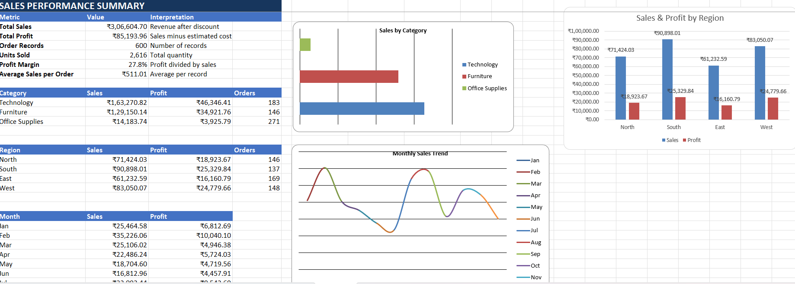
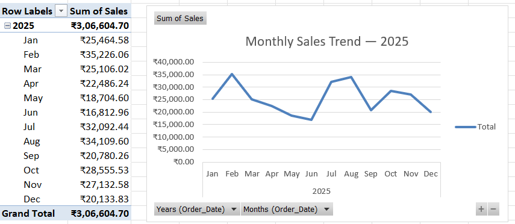
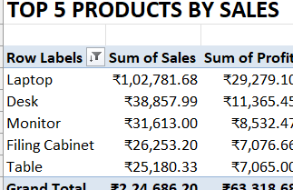

# Sales Performance Analysis | Excel & SQL

**Microsoft Excel • MySQL • SQL • Business Intelligence • Data Analysis**

An end-to-end sales performance analysis project using Microsoft Excel and MySQL to evaluate business performance, analyze regional sales, identify profitable product categories, and understand monthly sales trends.

The project analyzes **600 sales records from January to December 2025**, transforming raw transactional data into meaningful business insights through SQL queries, Excel PivotTables, KPI calculations, and visualizations.

> **Dataset Note:** This project uses synthetic practice data for educational and portfolio purposes. It does not represent the actual performance of a real company.

---

## 📑 Table of Contents

1. About This Project
2. Problem Statement
3. Business Questions
4. Project Objectives
5. Dataset Overview
6. Project Structure
7. Methodology
   - Data Preparation
   - SQL Business Analysis
   - Excel Analysis
   - KPI Calculation
8. Dashboard & Visualizations
9. Key Findings
10. Business Recommendations
11. Technical Specifications
12. How to Review the Project
13. Data Quality & Validation
14. Limitations
15. Skills Demonstrated
16. Author

---

## 1. About This Project

Sales performance analysis helps businesses understand how effectively they generate revenue and profit across different products, categories, and geographical regions.

This project uses Microsoft Excel and MySQL to analyze sales transactions, calculate key performance indicators, compare regional and category performance, and identify changes in monthly sales.

The project combines SQL-based business analysis with Excel-based reporting and visualization.

**The project demonstrates:**

- SQL-based data analysis using MySQL.
- Business KPI calculations using aggregate functions.
- Regional and category-wise sales analysis.
- Identification of top-performing products.
- Monthly sales and profit trend analysis.
- Excel PivotTables and interactive charts.
- Data quality checks and validation.
- Business insight generation and recommendations.

---

## 2. Problem Statement

Businesses generate sales data through daily transactions, but raw transactional records alone do not provide a clear understanding of business performance.

Management needs to understand which regions generate the most revenue, which categories contribute the highest profit, which products perform well, and how sales change throughout the year.

This project analyzes sales transaction data to identify performance patterns and provide insights that can support better business decisions.

---

## 3. Business Questions

The project focuses on answering the following business questions:

| No. | Business Question |
|---|---|
| 01 | What are the total sales and total profit? |
| 02 | Which region generates the highest sales? |
| 03 | Which region generates the highest total profit? |
| 04 | Which region has the highest profit margin? |
| 05 | Which product category contributes the most sales and profit? |
| 06 | Which five products generate the highest sales? |
| 07 | How do sales and profit change throughout the year? |
| 08 | What opportunities could improve sales planning and profitability? |

---

## 4. Project Objectives

- Analyze overall sales and profit performance.
- Calculate important business KPIs.
- Compare sales and profitability across regions.
- Evaluate category-wise sales and profit contribution.
- Identify the top five products by sales.
- Analyze monthly sales and profit trends.
- Perform SQL-based business analysis using MySQL.
- Build an Excel-based performance summary.
- Generate actionable business recommendations.

---

## 5. Dataset Overview

The project uses a synthetic sales dataset containing **600 transaction records covering January to December 2025**.

The dataset includes information about orders, products, regions, quantities, prices, discounts, estimated costs, and customer segments.

### Dataset Summary

| Attribute | Details |
|---|---|
| Total Records | 600 |
| Analysis Period | January – December 2025 |
| Data Format | CSV |
| Number of Regions | 4 |
| Product Categories | 3 |
| Analysis Type | Descriptive Business Analysis |
| Primary Tools | Excel and MySQL |

### Key Columns

| Column | Description |
|---|---|
| Order_ID | Unique order identifier |
| Order_Date | Date of the order |
| Region | Sales region |
| Category | Product category |
| Product | Product name |
| Quantity | Number of units sold |
| Unit_Price | Price per unit |
| Discount | Discount applied |
| Sales | Revenue after discount |
| Cost | Estimated product cost |
| Profit | Sales minus estimated cost |
| Customer_Segment | Customer segment |
| Month | Month associated with the order |

---

## 6. Project Structure

```text
sales-performance-analysis/
│
├── data/
│   └── sales_data1.csv
│
├── sql/
│   ├── 01_database_setup.sql
│   ├── 02_kpi_analysis.sql
│   ├── 03_region_analysis.sql
│   ├── 04_category_analysis.sql
│   ├── 05_top_products.sql
│   ├── 06_sales_case_analysis.sql
│   ├── 07_monthly_sales_trend.sql
│   └── 08_data_quality_checks.sql
│
├── Screenshots/
│   ├── Sales_Performance_Summary.png
│   ├── Monthly_Sales_Trend.png
│   └── Top_5_Products.png
│
├── Sales_Performance_Analysis.xlsx
│
└── README.md
```

---

## 7. Methodology

### 1. Data Preparation

The project begins with the sales transaction dataset.

The data is used as the source for SQL analysis and Excel-based reporting.

Key activities include:

- Understanding the dataset structure.
- Reviewing important columns.
- Checking missing and duplicate records.
- Reviewing date ranges and numeric values.
- Preparing the database tables for SQL analysis.

### 2. SQL Business Analysis

MySQL is used to perform business analysis through structured queries.

The SQL scripts are organized according to different analytical requirements.

| SQL File | Purpose |
|---|---|
| 01_database_setup.sql | Database and table preparation |
| 02_kpi_analysis.sql | Overall sales and profit KPIs |
| 03_region_analysis.sql | Region-wise performance |
| 04_category_analysis.sql | Category-wise analysis |
| 05_top_products.sql | Top five products by sales |
| 06_sales_case_analysis.sql | Sales classification using CASE |
| 07_monthly_sales_trend.sql | Monthly sales and profit trends |
| 08_data_quality_checks.sql | Data quality validation |

### 3. Excel Analysis

Microsoft Excel is used to summarize and visualize the results.

The workbook includes:

- KPI summary.
- Category performance analysis.
- Regional sales and profit comparison.
- Top five products by sales.
- Monthly sales trend.
- PivotTables and charts.
- Business performance summary.

### 4. KPI Calculation

The project calculates the following key performance indicators.

| KPI | Calculation |
|---|---|
| Total Sales | SUM(Sales) |
| Total Profit | SUM(Profit) |
| Order Records | COUNT(Order_ID) |
| Units Sold | SUM(Quantity) |
| Profit Margin | (Total Profit / Total Sales) × 100 |
| Average Sales per Record | Total Sales / Order Records |

**Profit Margin Formula**

```sql
ROUND(
    SUM(Profit) / SUM(Sales) * 100,
    2
) AS profit_margin
```

These KPIs help evaluate overall business performance and profitability.

---

## 8. Dashboard & Visualizations

The Excel workbook presents the analytical findings through KPI summaries, PivotTables, and charts.

### 1. Sales Performance Summary

The summary provides an overview of total sales, total profit, order records, units sold, profit margin, and average sales per record.

It also presents category-wise performance, regional comparisons, and monthly sales and profit information.



### 2. Monthly Sales Trend

The monthly sales trend visualizes sales performance from January to December 2025.

It helps identify months with relatively higher and lower sales and understand changes in sales performance throughout the year.



### 3. Top Five Products by Sales

This analysis identifies the five products generating the highest sales and compares their corresponding profit contributions.



---

## 9. Key Findings

Based on the initial Excel analysis, the following findings were identified.

### 1. Overall Sales Performance

| KPI | Result |
|---|---:|
| Total Sales | ₹3,06,604.70 |
| Total Profit | ₹85,193.96 |
| Order Records | 600 |
| Units Sold | 2,616 |
| Profit Margin | 27.79% |
| Average Sales per Record | ₹511.01 |

**Interpretation:** The dataset records ₹3.06 lakh in sales and approximately ₹85,194 in profit, with an overall profit margin of 27.79%.

### 2. Regional Performance

| Region | Sales | Profit |
|---|---:|---:|
| North | ₹71,424.03 | ₹18,923.67 |
| South | ₹90,898.01 | ₹25,329.84 |
| East | ₹61,232.59 | ₹16,160.79 |
| West | ₹83,050.07 | ₹24,779.66 |

**Key Finding:**

South recorded the highest sales and total profit among the four regions.

West recorded the second-highest sales and a comparatively strong total profit.

**Interpretation:** South is the leading region in terms of total sales and profit within the analyzed dataset.

### 3. Category Performance

| Category | Sales | Profit |
|---|---:|---:|
| Technology | ₹1,63,270.82 | ₹46,346.41 |
| Furniture | ₹1,29,150.14 | ₹34,921.76 |
| Office Supplies | ₹14,183.74 | ₹3,925.79 |

**Key Finding:**

Technology generated the highest sales and profit among the three product categories.

**Interpretation:** Technology is the largest contributor to sales and profit in this dataset.

### 4. Top Five Products by Sales

| Product | Sales | Profit |
|---|---:|---:|
| Laptop | ₹1,02,781.68 | ₹29,279.10 |
| Desk | ₹38,857.99 | ₹11,365.45 |
| Monitor | ₹31,613.00 | ₹8,532.47 |
| Filing Cabinet | ₹26,253.20 | ₹7,076.66 |
| Table | ₹25,180.33 | ₹7,065.00 |

**Key Finding:**

Laptop recorded the highest sales and profit among the five products.

**Interpretation:** Laptop is the leading product in the analyzed dataset based on both sales and profit.

### 5. Monthly Sales Performance

| Month | Sales |
|---|---:|
| January | ₹25,464.58 |
| February | ₹35,226.06 |
| March | ₹25,106.02 |
| April | ₹22,486.24 |
| May | ₹18,704.60 |
| June | ₹16,812.96 |
| July | ₹32,092.44 |
| August | ₹34,109.60 |
| September | ₹20,780.26 |
| October | ₹28,555.53 |
| November | ₹27,132.58 |
| December | ₹20,133.83 |

**Key Findings:**

- February recorded the highest monthly sales of ₹35,226.06.
- June recorded the lowest monthly sales of ₹16,812.96.
- July and August also recorded relatively high sales.

**Interpretation:** Sales varied across the year, indicating that monthly performance should be monitored for better sales and inventory planning.

---

## 10. Business Recommendations

Based on the observed findings, the following recommendations can be considered.

**1. Regional Performance**

Investigate the factors contributing to South's higher sales and profit. Evaluate whether successful sales practices can be replicated in other regions.

**2. Product Planning**

Review laptop sales performance, inventory availability, and profit contribution before making product stocking and promotional decisions.

**3. Category Management**

Monitor Technology category performance and evaluate opportunities to improve the contribution of Furniture and Office Supplies.

**4. Monthly Sales Planning**

Investigate the reasons behind monthly sales fluctuations and use historical trends to support inventory and sales planning.

**5. Profitability Monitoring**

Compare profit margins across products, categories, and regions instead of relying only on total sales.

These recommendations are based on patterns observed in synthetic practice data and are not measured improvements or guaranteed business outcomes.

---

## 11. Technical Specifications

| Component | Technology / Approach |
|---|---|
| Spreadsheet Analysis | Microsoft Excel |
| Database | MySQL |
| Query Language | SQL |
| Data Aggregation | SUM(), COUNT() |
| Grouping | GROUP BY |
| Sorting | ORDER BY |
| Filtering | WHERE, HAVING |
| Conditional Analysis | CASE WHEN |
| Data Limiting | LIMIT |
| Date Analysis | SQL Date Functions |
| Visualization | Excel Charts |
| Reporting | PivotTables and KPI Summary |
| Version Control | Git and GitHub |

---

## 12. How to Review the Project

### Step 1: Clone the Repository

```bash
git clone https://github.com/mitesh256/sales-performance-analysis.git
```

```bash
cd sales-performance-analysis
```

### Step 2: Review the Dataset

Open the `data/` folder and inspect `sales_data1.csv`.

### Step 3: Set Up MySQL

- Open MySQL Workbench.
- Execute `01_database_setup.sql`.
- Prepare the database and import the source dataset.
- Configure the database and table names according to your local environment.

### Step 4: Run SQL Queries

Execute the SQL scripts in the following order:

1. KPI Analysis
2. Regional Analysis
3. Category Analysis
4. Top Products Analysis
5. Sales Case Analysis
6. Monthly Sales Trend
7. Data Quality Checks

Review the outputs to understand the business calculations and analytical results.

### Step 5: Open the Excel Workbook

Open:

`Sales_Performance_Analysis.xlsx`

Explore the KPI summary, PivotTables, charts, and monthly sales trends.

---

## 13. Data Quality & Validation

The project includes SQL checks for:

- Missing values in important columns.
- Duplicate order IDs.
- Earliest and latest order dates.
- Invalid numeric values.
- Consistency between Excel and SQL calculations.

Excel and SQL results should be reconciled before publishing final verified outputs.

---

## 14. Limitations

- The dataset is synthetic and intended for educational and portfolio purposes.
- The analysis is limited to the available dataset columns.
- The project focuses on descriptive business analysis rather than predictive modelling.
- Profit is calculated using the estimated cost values provided in the dataset.
- The analysis does not establish the causes of monthly sales fluctuations.
- The project does not measure actual revenue growth, cost savings, or return on investment.

---

## 15. Skills Demonstrated

- Microsoft Excel
- PivotTables and Excel Charts
- MySQL and SQL
- Data Aggregation and Grouping
- KPI Calculation
- Regional Performance Analysis
- Product and Category Analysis
- Monthly Trend Analysis
- Data Quality Validation
- Business Insights
- Data-Driven Recommendations

---

## 16. Author

**Mitesh Suthar**

Aspiring Data Analyst | Excel | SQL | Python | Power BI

- GitHub: [mitesh256](https://github.com/mitesh256)
- LinkedIn: [Mitesh Suthar](https://linkedin.com/in/mitesh-suthar256cse2026)

**Project Type:** Data Analytics Portfolio Project

**Tools:** Microsoft Excel, MySQL, SQL

**Dataset:** Synthetic Sales Data

---

*Turning sales transactions into meaningful business insights.*

⭐ If you find this project useful, feel free to explore the repository.
